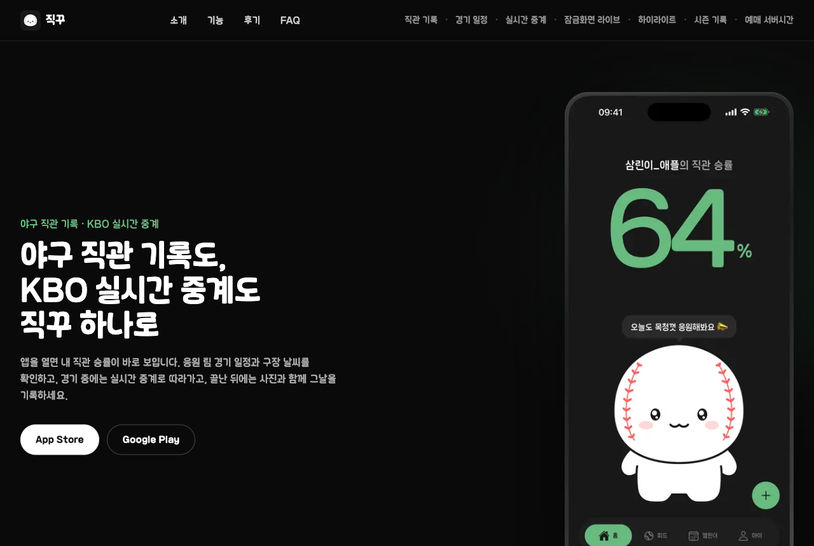
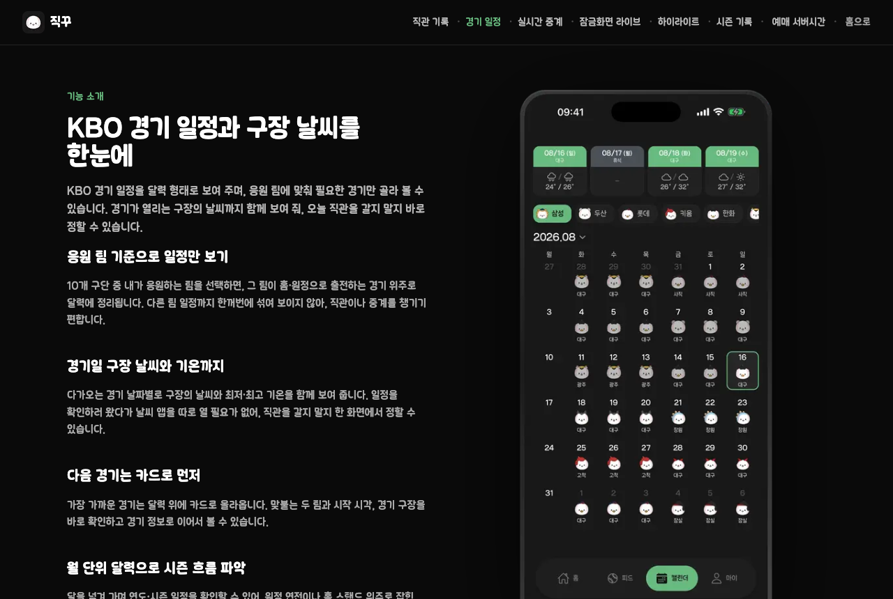

# [직꾸](https://www.jik-kku.com/)

❓ Problem : 경기 일정, 날씨, 중계, 직관 기록을 보려고 앱을 여러 개 옮겨 다녀야 할 때! 😮

❗️ Idea : 경기 전 일정 확인부터 경기 중 중계, 경기 후 기록까지 한 앱에서 이어지면 좋지 않을까? 🤔

💯 Solution : 일정, 실시간 중계, 직관 기록을 하나로 묶은 야구 팬용 앱을 만들자!! 😁

 

## 프로젝트 소개

야구 직관 기록 앱 직꾸의 웹 저장소

- 앱 소개 랜딩 페이지와 기능별 소개 페이지
- 앱: [App Store](https://apps.apple.com/kr/app/%EC%A7%81%EA%BE%B8/id6761379053) | [Google Play](https://play.google.com/store/apps/details?id=com.jikkku.app)
- 함께 운영하는 예매 도우미: [직꾸 티켓](https://github.com/choisuhyeok1255/jik-kku-ticket)

 

## 기술 스택

Next.js, TypeScript, TanStack Query, Zustand, Tailwind CSS, shadcn/ui, Supabase, Vercel

 

## 기능

### 랜딩 페이지

- 앱 소개, App Store와 Google Play 바로가기
- 사용자 후기, 자주 묻는 질문

 

### 기능 소개 페이지

- [직관 기록](https://www.jik-kku.com/easy-game-log), [경기 일정](https://www.jik-kku.com/kbo-calendar), [실시간 중계](https://www.jik-kku.com/live-score)
- [잠금화면 라이브](https://www.jik-kku.com/lock-screen-live), [하이라이트](https://www.jik-kku.com/youtube-highlight), [시즌 기록](https://www.jik-kku.com/season-record)

 

## 운영 문서

- [Slack 알림](docs/slack-notify.md)
- [경기 데이터 자동 동기화](docs/cron-sync.md)
- [웹폰트 분리](docs/font-split.md)
